# PrintForge

**Custom ideas. Physical creations.**

PrintForge is a full-stack e-commerce platform for a 3D-printing studio. Customers can shop a ready-made catalogue of printed objects, or upload their own STL/3MF/OBJ file and request a custom print that an admin reviews, quotes, and moves through production.

Built as a realistic, portfolio-quality MVP — clean layered architecture, real authentication and authorization, no unnecessary complexity (no microservices, no payment gateway, no automated STL analysis).

## Features

**Customer**
- Register / log in (JWT in an httpOnly cookie, BCrypt-hashed passwords)
- Forgot password (emailed one-time link), account settings (name, change password)
- Browse, search, filter, and sort the product catalogue
- Product detail pages with related products
- Cart with quantity controls, persisted locally
- Light and dark themes: follows the device setting, with a header toggle that is remembered (applied before the first paint, so pages never flash the wrong theme); switching to dark spreads a soft glow out of the moon button, and switching back gathers the dark back into the sun
- Checkout with cash-on-delivery / demo payment, server-side stock validation
- Order history with a visual status tracker (Placed → Confirmed → Printing → Ready → Shipped → Delivered), the tracking number, and a timeline of every change
- Confirm a delivered order arrived, or report within 14 days that it did not
- Upload a custom 3D model (STL / 3MF / OBJ, up to 20MB) with material, color, quantity, and notes
- View custom print request status, accept or reject an admin quote

**Admin**
- Dashboard with key stats (products, orders, pending orders, open delivery problems, custom requests, revenue) and recent activity
- Full product CRUD with stock and category management, plus a real photo upload per product
- Category CRUD (delete blocked while products still reference it)
- Order list and status management; shipping requires a tracking number, and each order page shows its full history (who changed what, when) and lets staff resolve "not received" reports
- Custom print request review: download the uploaded file, send a quote, update production status

## Screenshots

Captured from a disposable local stack with the seeded demo data only (demo accounts, generated placeholder product photos, orders placed by the end-to-end tests).

| Storefront | Product detail |
|---|---|
| 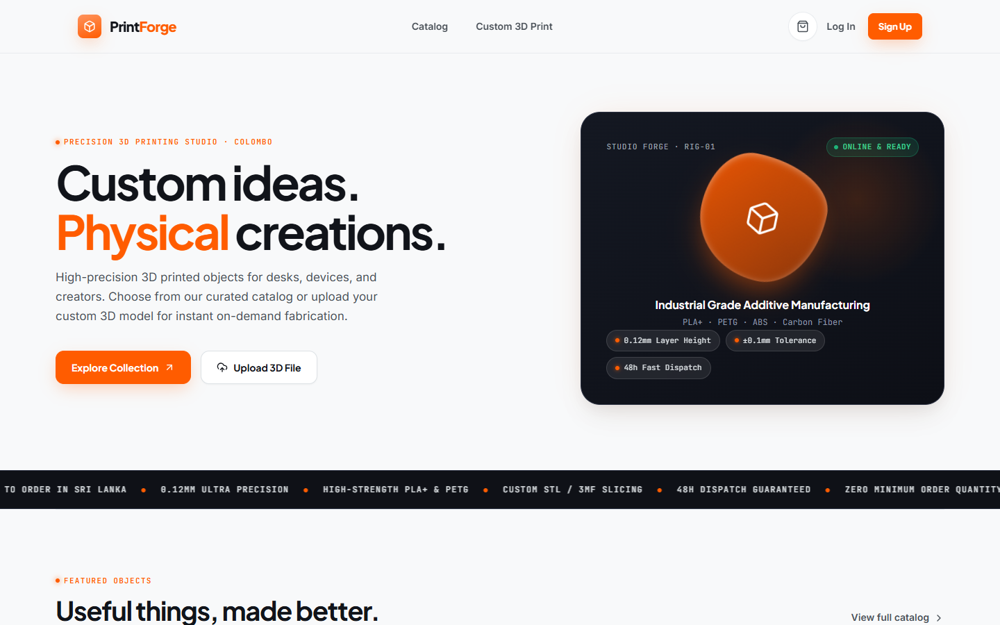 | 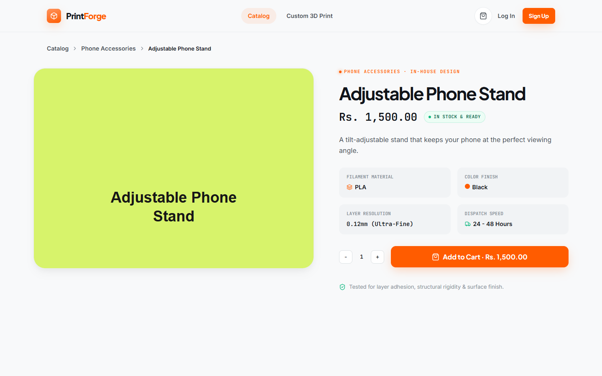 |
| **Catalogue** | **Cart** (prices refreshed from the server, free-delivery threshold) |
| 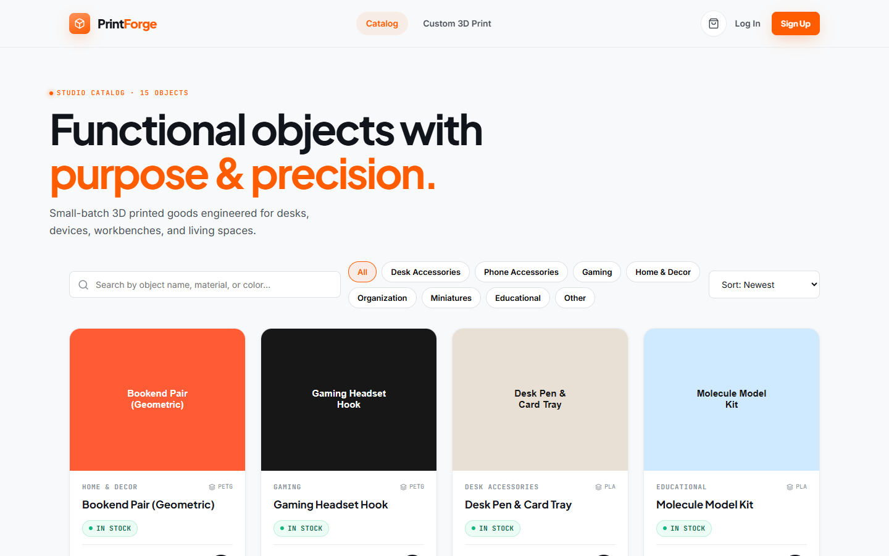 | 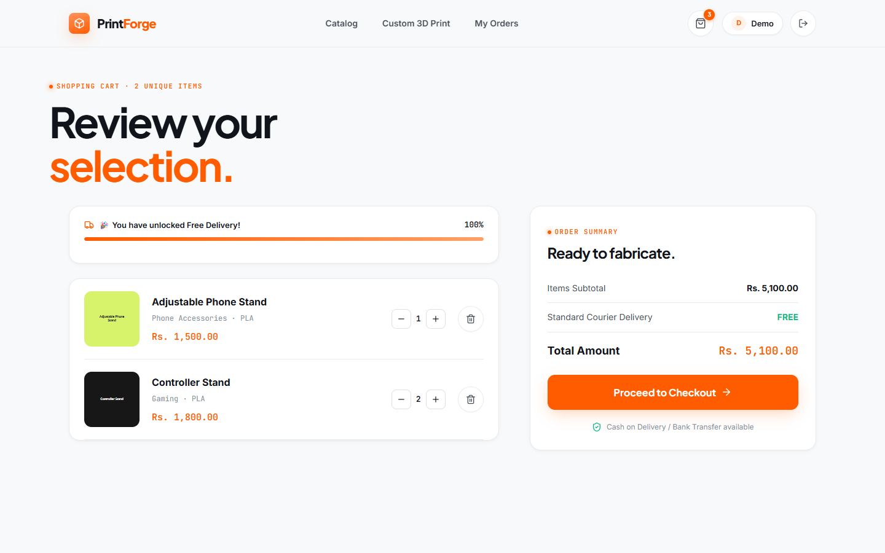 |
| **Custom print upload** | **Admin dashboard** |
| 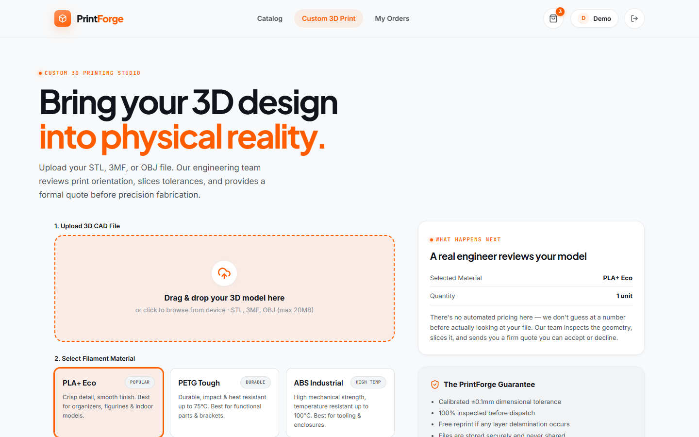 | 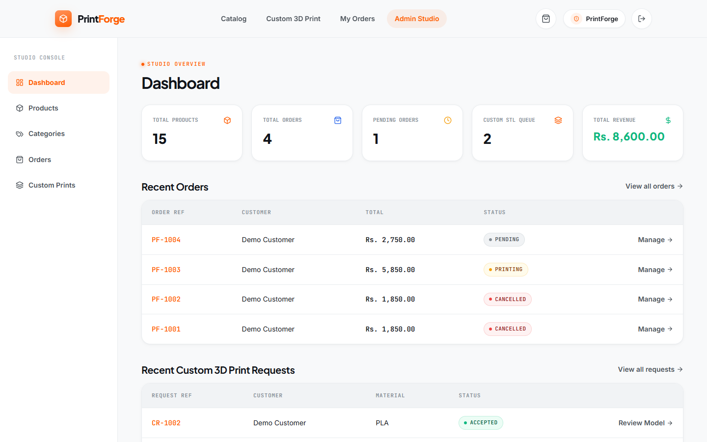 |
| **Admin products** | **Admin orders** (only valid next statuses offered) |
| 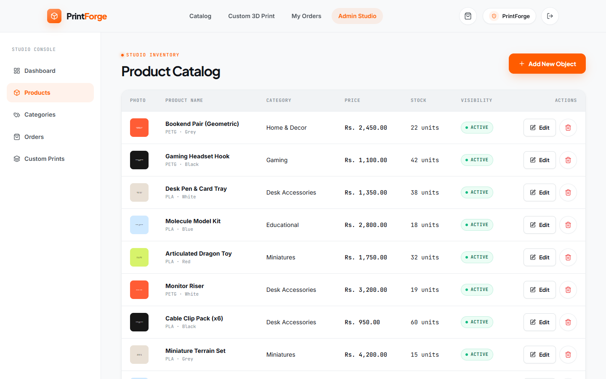 | 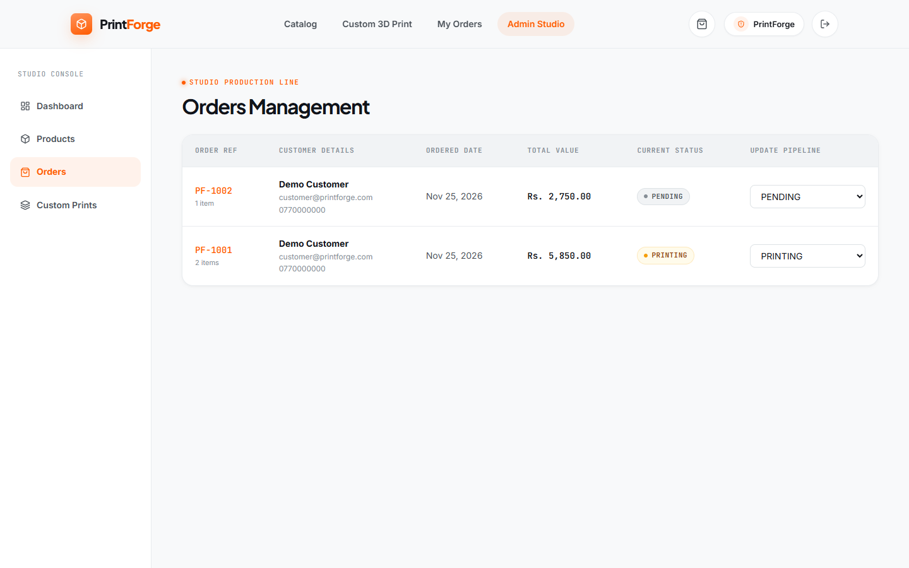 |
| **Admin categories** | **My Orders** (orders and custom print requests) |
| 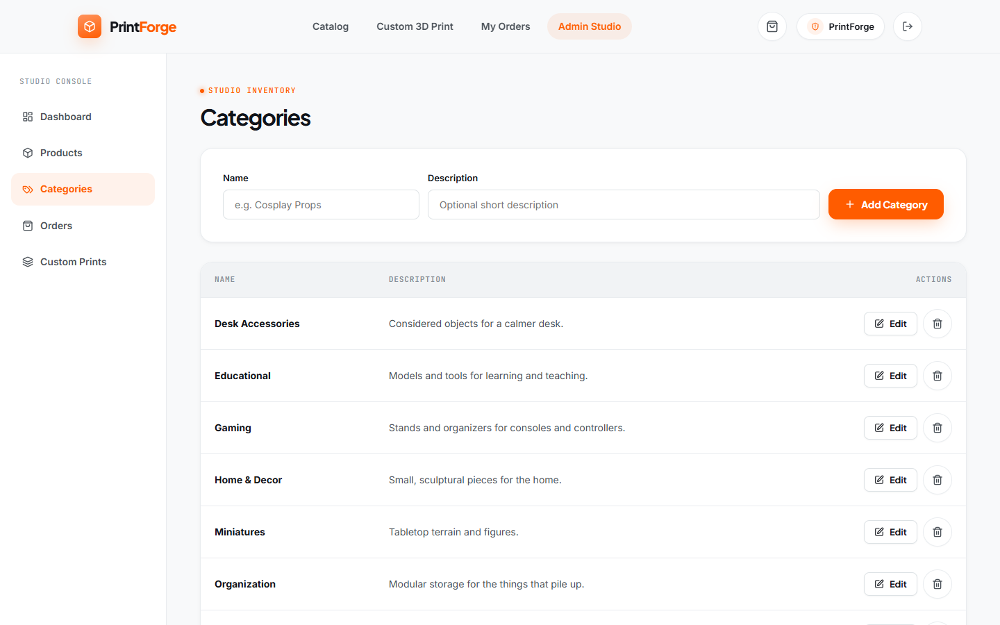 | 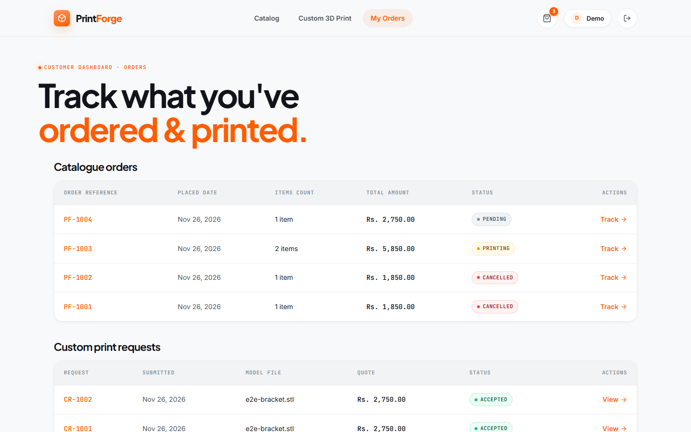 |
| **Account settings** | |
| 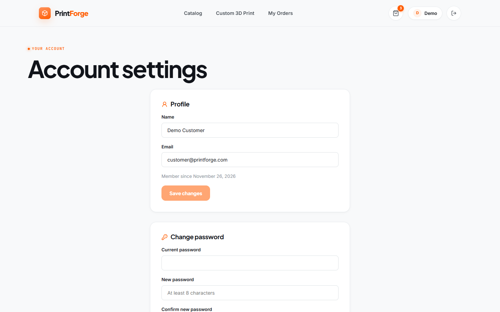 | |

## Tech Stack

**Backend:** Java 21, Spring Boot 4.1, Spring Web MVC, Spring Data JPA, Spring Security (JWT), Bean Validation, Flyway, Lombok, Maven
**Database:** PostgreSQL
**Frontend:** Next.js 16 (App Router), React 19, TypeScript, hand-rolled CSS design system (no UI framework)
**Testing:** JUnit 5, Spring Boot Test, MockMvc, H2 (in-memory, test-only)

## Architecture

```
PrintForge/
├── backend/     Spring Boot API (controller → service → repository → entity, dto, security, exception, config)
├── frontend/    Next.js App Router client (app, components, lib, hooks via React state/context)
└── screenshots/
```

The backend never exposes JPA entities over HTTP — every endpoint returns a DTO. Role-based access is enforced server-side with Spring Security (`@PreAuthorize` + request matchers); the frontend never dictates permissions, it just reflects what the API allows. The frontend keeps cart state in `localStorage` (no persistent cart table) and calls the API directly with a small `fetch` wrapper — no data-fetching library was needed at this scale.

## Database Design

| Table | Notes |
|---|---|
| `users` | `id, name, email (unique), password (BCrypt), role, created_at` |
| `category` | `id, name (unique), description` |
| `product` | `id, name, description, price, stock_quantity, material, color, image_url, category_id, active, created_at, updated_at` |
| `customer_orders` | `id, order_number (PF-1001…), customer_id, subtotal, delivery_fee, total_amount, status, shipping_*, tracking_number, delivered_at, received_at, issue_reported_at, issue_note, issue_resolved_at, issue_resolution, created_at, updated_at` |
| `order_event` | `id, order_id, event_type (PLACED, STATUS_CHANGED, RECEIVED, ISSUE_REPORTED, ISSUE_RESOLVED), status, actor_name, actor_email, actor_role, note, created_at` (order history) |
| `order_item` | `id, order_id, product_id, product_name, quantity, unit_price, subtotal` — product name/price are snapshotted so past orders stay correct if a product changes later |
| `custom_print_request` | `id, request_number (CR-1001…), customer_id, file_name, file_path, file_type, material, color, quantity, notes, status, admin_quote, admin_notes, created_at, updated_at` |

Relationships: one customer → many orders and many custom print requests; one order → many order items; one category → many products.

**Schema migrations:** the schema is owned by [Flyway](https://flywaydb.org/) migrations in `backend/src/main/resources/db/migration` and applied automatically on startup; Hibernate only validates that the entities match (`ddl-auto: validate`). To change the schema, add a new `V<n>__description.sql` file — never edit one that has already run. Databases created before Flyway was adopted are baselined at version 1 on first start and then receive later migrations. The test suite runs the same migrations on H2, so a migration that drifts from the entities fails the build.

**Order status:** `PENDING → CONFIRMED → PRINTING → READY → SHIPPED → DELIVERED`, or `CANCELLED`. Orders only move forward and production steps may be skipped, but `SHIPPED` needs a tracking number and `DELIVERED` can only follow `SHIPPED`, so an order is never marked delivered without a shipment. Orders can be cancelled until they ship; cancelling returns the items to stock. `DELIVERED` and `CANCELLED` are final. Every change is recorded with who made it (customers see staff as "PrintForge studio").

**After delivery:** the customer can confirm the order arrived, or within 14 days report that it did not. A report shows on the admin dashboard and orders list until staff resolve it with an explanation the customer sees. A delivered order with no confirmation and no open report counts as received once the 14 days pass.

**Custom print status:** `SUBMITTED → UNDER_REVIEW → QUOTED → ACCEPTED → IN_PRODUCTION → COMPLETED`, or `REJECTED` / `CANCELLED`. `QUOTED` is reached only by sending a quote (which can be revised until the customer answers); `ACCEPTED` / `REJECTED` are set only by the customer; admins drive the remaining steps and can cancel until completion. `REJECTED`, `COMPLETED` and `CANCELLED` are final.

Order and request responses include `nextStatuses` — the moves the server will accept — so clients never need to duplicate these rules.

**Order and request numbers** (`PF-…`, `CR-…`) are derived from the database id, so they stay unique when orders are placed concurrently. Stock is decremented under a row lock, so simultaneous orders cannot oversell.

**Editing stock safely:** `PUT /api/products/{id}` accepts an optional `expectedStockQuantity` — the stock value the editor was loaded with. If the submitted `stockQuantity` equals it, the live stock is kept (so sales made while the form was open are not undone); if it differs and the stock has moved in the meantime, the update is rejected with `409` and the current value. The admin form always sends it; without it, `stockQuantity` overwrites the stock.

## Authentication

JWT sessions, BCrypt password hashing. Public registration always creates a `CUSTOMER` — there is no way to self-register as `ADMIN`.

**Browser sessions** live in an **httpOnly cookie** (`pf_session`: HttpOnly, SameSite=Lax, Path=/api, Secure whenever the request arrives over HTTPS), so page scripts — including any injected by an XSS bug — can never read the token; the frontend stores only the user's public details. Because the browser attaches the cookie automatically, every state-changing request authenticated by it must also carry a **CSRF token** (double-submit: the frontend reads it from `GET /api/auth/csrf` and sends it in the `X-XSRF-TOKEN` header; a stale token gets `403` with `"code":"CSRF"` and is refreshed automatically). Non-browser clients can still send `Authorization: Bearer <token>` instead, which needs no CSRF token. The cookie is sent cross-origin to the API, so the frontend and API must be on the same site (e.g. `localhost`, or `shop.example.com` + `api.example.com`) and the frontend's origin must be listed in `CORS_ALLOWED_ORIGINS`.

A token only identifies the user: on every request the server re-reads the account and takes the role from the database (never from the token or the client), so a role change applies immediately and a deleted account stops working. Each token carries the user's token version; logging out (`POST /api/auth/logout`) bumps it and clears the cookie, revoking all of that user's sessions on every device. Invalid, expired, revoked or missing tokens return `401`; valid tokens without the right role return `403`.

## API Endpoints

| Method | Path | Auth | Description |
|---|---|---|---|
| POST | `/api/auth/register` | Public | Register (always `CUSTOMER`); sets the session cookie, returns `{id, name, email, role}` |
| POST | `/api/auth/login` | Public | Log in; sets the httpOnly session cookie, returns `{id, name, email, role}` (never the token) |
| GET | `/api/auth/me` | Authenticated | The signed-in user (used to restore a browser session) |
| GET | `/api/auth/csrf` | Public | `{headerName, token}` to echo on cookie-authenticated writes |
| POST | `/api/auth/forgot-password` | Public | Email a one-time reset link (always `202`, so it never reveals whether an account exists; rate-limited) |
| POST | `/api/auth/reset-password` | Public | `{token, password}`: set a new password from a reset link (30-minute, single-use); signs out everywhere |
| GET/PUT | `/api/account` | Authenticated | View the account / change the name |
| PUT | `/api/account/password` | Authenticated | `{currentPassword, newPassword}`: other sessions are signed out, this one gets a fresh cookie |
| POST | `/api/auth/logout` | Authenticated | Revoke all of the caller's tokens (every device); `204` |
| GET | `/api/products` | Public | List active products (`?search=` and `?category=` combine; `?ids=1,2,3` returns just those, max 100) |
| GET | `/api/products/{id}` | Public | Product detail (404 for inactive/archived products) |
| GET | `/api/admin/products/{id}` | ADMIN | Product detail including inactive products |
| GET | `/api/products/{id}/image` | Public | Product photo — serves the uploaded file, else redirects to the admin-set image URL, else a generated placeholder. Pass `?v=<imageVersion>` for a long-cached URL; unversioned requests are revalidated |
| POST | `/api/products/{id}/image` | ADMIN | Upload/replace a product's photo (multipart: `file`, max 5MB, JPG/PNG/WEBP/GIF) |
| POST/PUT/DELETE | `/api/products[/{id}]` | ADMIN | Manage products |
| GET | `/api/categories` | Public | List categories |
| GET | `/api/shop/settings` | Public | `{ deliveryFee, freeDeliveryThreshold }` used to price orders |
| POST/PUT/DELETE | `/api/categories[/{id}]` | ADMIN | Manage categories (delete blocked if products reference it) |
| POST | `/api/orders` | CUSTOMER | Place an order (validates stock, transactional). Optional `expectedTotal`: rejected with `409` if prices changed since the customer saw it |
| GET | `/api/orders` / `/api/orders/{id}` | CUSTOMER | Own orders only (with tracking number and history) |
| PUT | `/api/orders/{id}/received` | CUSTOMER | Confirm a delivered order arrived |
| PUT | `/api/orders/{id}/not-received` | CUSTOMER | Report a delivered order as not received, within 14 days. Optional `{ note }` |
| GET | `/api/admin/orders` / `/api/admin/orders/{id}` | ADMIN | All orders / one order, with staff names in the history |
| PUT | `/api/admin/orders/{id}/status` | ADMIN | Update order status: `{ status, trackingNumber?, note? }`; `trackingNumber` is required for `SHIPPED` |
| PUT | `/api/admin/orders/{id}/issue/resolve` | ADMIN | Resolve a "not received" report: `{ resolution }` (shown to the customer) |
| POST | `/api/custom-prints` | CUSTOMER | Submit a custom print request (multipart: `file, material, color, quantity, notes`) |
| GET | `/api/custom-prints` / `/{id}` | CUSTOMER | Own requests only |
| PUT | `/api/custom-prints/{id}/accept` | `/reject` | CUSTOMER | Respond to a quote. Accept takes an optional `{ expectedQuote }`: rejected with `409` if the studio revised the quote since the customer saw it (the storefront always sends it) || `/reject` | CUSTOMER | Respond to a quote |
| GET | `/api/admin/custom-prints` / `/{id}` | ADMIN | All requests |
| GET | `/api/admin/custom-prints/{id}/file` | ADMIN | Download the uploaded model |
| PUT | `/api/admin/custom-prints/{id}/quote` | ADMIN | Send a quote (`amount, notes`) |
| PUT | `/api/admin/custom-prints/{id}/status` | ADMIN | Update production status |
| GET | `/api/admin/dashboard` | ADMIN | Summary stats + recent activity |

Errors are returned as consistent JSON: `{ "message", "status", "timestamp" }` (validation errors also include a per-field `errors` map). Stack traces are never exposed to clients.

## How to Run

### With Docker (quickest)

Needs only Docker. From the repository root:

```bash
cp .env.example .env      # set DB_PASSWORD and a long random JWT_SECRET (e.g. openssl rand -base64 48);
                          # SEED_DEMO_DATA=true gives you the demo accounts and products
docker compose up --build # storefront: http://localhost:3000, API: http://localhost:8080
```

This runs PostgreSQL, the API and the storefront (`docker-compose.yml`); the database and uploaded files persist in named volumes (`docker compose down -v` removes them). The API image runs as an unprivileged user. `NEXT_PUBLIC_API_URL` is compiled into the storefront at build time, so rebuild the `web` image after changing it. For a real deployment put both behind HTTPS on the same site (e.g. `shop.example.com` and `api.example.com`), set `FRONTEND_URL`, `CORS_ALLOWED_ORIGINS` and the `MAIL_*` settings, and leave `SEED_DEMO_DATA` unset.

### Without Docker

**Prerequisites:** Java 21, Maven, Node.js 20.9+, PostgreSQL running locally.

```bash
# 1. Create an empty database (name must match DB_NAME below)
createdb printforge   # or: psql -U postgres -c "CREATE DATABASE printforge"

# 2. Backend
cd backend
cp ../.env.example .env   # then fill in your real DB password and a JWT secret
mvn spring-boot:run       # http://localhost:8080

# 3. Frontend (separate terminal)
cd frontend
npm install
echo "NEXT_PUBLIC_API_URL=http://localhost:8080/api" > .env.local
npm run dev                # http://localhost:3000
```

Demo data (8 categories, 15 products with photos, 1 admin, 1 customer) is created on first boot against an empty database **only when `SEED_DEMO_DATA=true`** — the `.env.example` you copied sets it for local development. It is off by default; never enable it in a real deployment.

The demo product photos live in `backend/src/main/resources/seed/product-images/` (one `<product-name-slug>.jpg` per product) and are copied into `PRODUCT_IMAGE_DIR` when the products are seeded. Two are AI-generated (phone stand, cable management box); the rest are free stock photos from [Pexels](https://www.pexels.com/license/), used as stand-ins for the printed items.

**Run backend tests:** `cd backend && mvn test` — runs against an in-memory H2 database by default (no PostgreSQL needed), using the real `application.yml` plus the test overrides in `application-test.yml`. To run the same suite against PostgreSQL, set `TEST_DATABASE_URL`, `TEST_DATABASE_USERNAME` and `TEST_DATABASE_PASSWORD` to an empty, throwaway database.

**Lint and type-check the frontend:** `cd frontend && npm run lint && npm run typecheck`.

**End-to-end tests:** `frontend/e2e` holds Playwright tests that drive real user journeys in Google Chrome (buying and cancelling an order, shipping and delivering one with a "not received" report and confirmation, custom print upload → quote → acceptance, category management, registration, account settings, password reset, the cookie/CSP security guarantees, that every page fits a 360px phone screen, and the light/dark theme toggle). They **create accounts and orders and change passwords**, so run them only against a disposable stack: an empty database, the API started with `SEED_DEMO_DATA=true` and the frontend built and started. Then `cd frontend && E2E_DISPOSABLE=1 npm run e2e` (the suite refuses to run without that flag). Password reset links are read from Mailpit when `MAILPIT_URL` is set (as in CI), or from the API's log via `BACKEND_LOG=<path to the log>` when SMTP is not configured. `E2E_BASE_URL` / `E2E_API_URL` override the default `localhost:3000` / `localhost:8080/api`.

**Continuous integration:** `.github/workflows/ci.yml` runs on every push to `main` and every pull request: the backend suite on H2 and again on PostgreSQL 18; frontend lint, type-check and production build; and the end-to-end suite against a full stack (PostgreSQL, the API, the frontend and a Mailpit SMTP server), uploading the Playwright report and logs if it fails.

> **Why `printforge` and not `campusconnect`?** The environment's `campusconnect` database already holds an unrelated project's tables and a `users.role` check constraint incompatible with PrintForge's `CUSTOMER`/`ADMIN` roles. PrintForge uses its own dedicated database to avoid corrupting that project.

## Environment Variables

See [`.env.example`](.env.example). The backend loads `backend/.env` automatically on startup (via `spring.config.import`), so no shell exports are needed; real environment variables take precedence over it. Never commit a real `.env` — both `backend/.env` and `frontend/.env.local` are gitignored.

| Variable | Used by | Purpose |
|---|---|---|
| `DB_HOST`, `DB_PORT`, `DB_NAME`, `DB_USERNAME`, `DB_PASSWORD` | backend | PostgreSQL connection |
| `JWT_SECRET` | backend | **Required.** HMAC signing key for JWTs — a long random value (≥32 bytes). The backend refuses to start if it is missing, too short, or left as the `.env.example` placeholder |
| `SEED_DEMO_DATA` | backend | `true` to create the demo accounts and products on first boot against an empty database (default off; local development only) |
| `JWT_EXPIRATION` | backend | Token lifetime in ms (default 24h) |
| `UPLOAD_DIR` | backend | Where custom-print uploads are stored (default `backend/uploads/custom-prints`) |
| `CLOSED_UPLOAD_RETENTION_DAYS` | backend | Days after which a rejected or cancelled custom print request's model file is deleted by a daily job (default `30`; `0` keeps files forever). Completed requests keep theirs for reprints |
| `PRODUCT_IMAGE_DIR` | backend | Where uploaded product photos are stored (default `backend/uploads/products`) |
| `DELIVERY_FEE` | backend | Flat delivery fee per order in Rs. (default `350`). The storefront reads it from `GET /api/shop/settings` |
| `FREE_DELIVERY_THRESHOLD` | backend | Orders with a subtotal at or above this ship free (default `5000`); `0` switches free delivery off |
| `MAX_FAILED_LOGINS_PER_ACCOUNT`, `MAX_FAILED_LOGINS_PER_IP`, `LOGIN_LOCKOUT_WINDOW` | backend | Login throttling (defaults `5`, `20`, `15m`): after that many failed logins within the window, further attempts get `429` with `Retry-After` |
| `FORWARD_HEADERS_STRATEGY`, `TRUSTED_PROXIES` | backend | Behind a reverse proxy the client IP comes from `X-Forwarded-For` (default `native`), honoured only from trusted proxy addresses (default: private and loopback ranges, as a CIDR list). Set `TRUSTED_PROXIES` if your load balancer has a public address, or `FORWARD_HEADERS_STRATEGY=none` if nothing sits in front of the app |
| `FRONTEND_URL` | backend | Public address of the frontend, used for links in emails (default `http://localhost:3000`) |
| `MAIL_HOST`, `MAIL_PORT`, `MAIL_USERNAME`, `MAIL_PASSWORD`, `MAIL_FROM` | backend | SMTP for password reset emails (port `587` with STARTTLS by default; `MAIL_SMTP_AUTH`, `MAIL_STARTTLS` to adjust). If `MAIL_HOST` is empty, as in local development, reset links are written to the backend log instead — always configure SMTP in a real deployment |
| `CORS_ALLOWED_ORIGINS` | backend | Comma-separated origins the browser may call the API from (default `http://localhost:3000`); set to your deployed frontend URL |
| `NEXT_PUBLIC_API_URL` | frontend | Base URL the browser calls (default `http://localhost:8080/api`) |

## Demo Accounts

| Role | Email | Password |
|---|---|---|
| Admin | `admin@printforge.com` | `Admin@12345` |
| Customer | `customer@printforge.com` | `Customer@12345` |

Created by `DataSeeder` on first boot when `SEED_DEMO_DATA=true` (off by default) and only if the `users` table is empty, so the demo accounts can never be added to a database that has real users. Because these passwords are public, never enable demo seeding in a real deployment.

## Future Improvements

Deliberately out of scope for this MVP: Stripe/PayPal integration, cloud file storage, in-browser STL/3MF preview, automated model analysis or pricing, product reviews, wishlists, coupons, email notifications, shipping-carrier integration, multiple images per product, a production queue view, customer notifications, and a 3D product configurator.

## Project Structure

```
PrintForge/
├── backend/
│   ├── src/main/java/com/printforge/
│   │   ├── controller/   REST endpoints
│   │   ├── service/      business logic, transactions
│   │   ├── repository/   Spring Data JPA
│   │   ├── entity/       JPA entities
│   │   ├── dto/          request/response records (never expose entities)
│   │   ├── security/     JWT filter + service
│   │   ├── exception/    centralized error handling
│   │   └── config/       security, CORS, seed data
│   └── src/test/java/    JUnit + MockMvc tests
├── frontend/
│   ├── app/               Next.js App Router pages (customer + /admin)
│   ├── components/        Header, ProductCard, StatusBadge, OrderTracker, OrderHistory, DeliveryPanel, admin forms
│   └── lib/                api client, auth/cart context, types, route guards
├── screenshots/
└── .env.example
```
